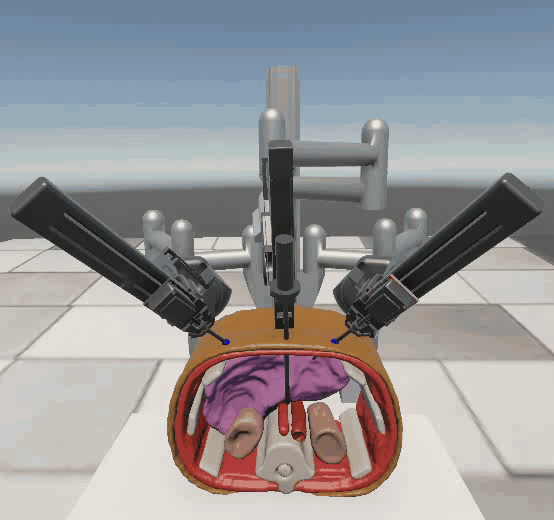
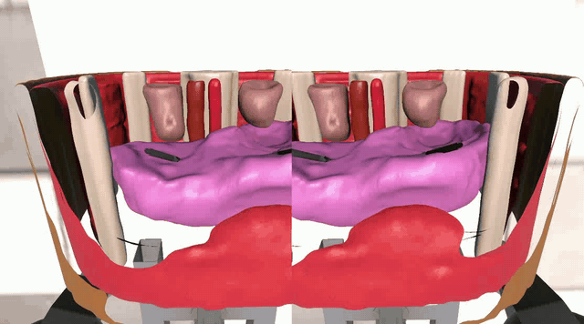
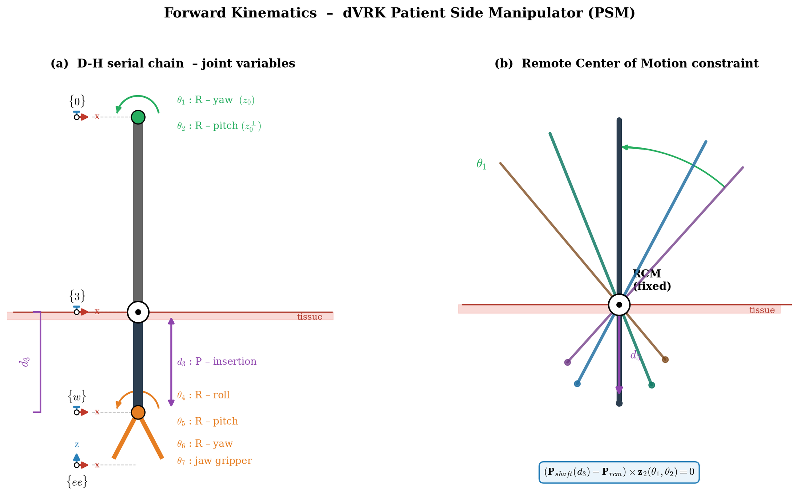
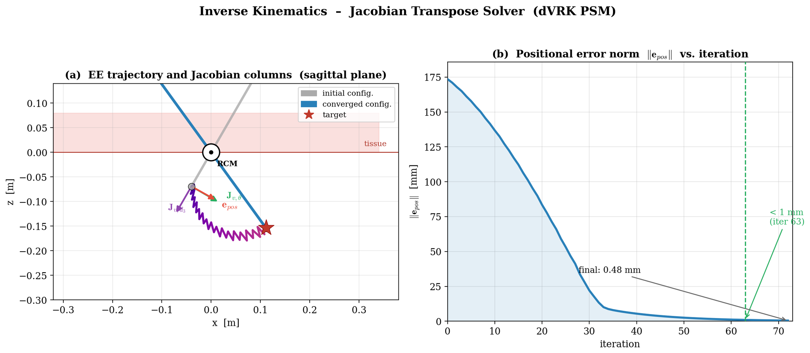
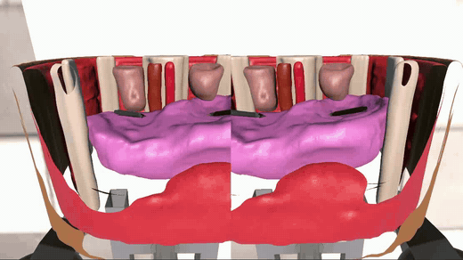

# Da Vinci VR Surgical Simulator

**Integration of a Realistic Phantom in the da Vinci Research Kit (dVRK) Simulator for an Educational Tool**

A native Unity/C# simulator of the da Vinci Research Kit with VR head-tracking and dual haptic feedback, built as a low-cost, ROS-free training alternative.

<p align="center"></p>

## The problem

The da Vinci Surgical System is the benchmark for robot-assisted minimally invasive surgery, and the dVRK is its open research platform, but the physical console is expensive to buy and maintain. This project replaces it with consumer VR and haptic hardware: two Geomagic Touch devices act as master manipulators with force feedback, and a Meta Quest 3 headset puts the operator's head inside the patient as the endoscopic camera. Kinematics, haptics and rendering all run natively in Unity, with no ROS or UDP middleware.

<p align="center"><br><sub>Endoscopic view (stereo, head-tracked)</sub></p>

## Approach

| | |
|---|---|
| **Robot model** | dVRK PSM and endoscope from CoppeliaSim, exported as a URDF kinematic chain and imported into Unity as PhysX `ArticulationBody` joints (this replaced an earlier Blender/FBX pipeline whose hand-aligned pivots caused self-collisions) |
| **Joint space** | q = [θ1 yaw, θ2 pitch, d3 insertion, θ4 θ5 θ6 wrist, θ7 jaw] ∈ R⁷, with the Remote Center of Motion kept by the parallelogram links |
| **Forward kinematics** | Clutched 1:1 joint-space mapping from the Geomagic stylus to stiff, well-damped PD joint drives, synced to the current pose at start-up to avoid jumps |
| **Inverse kinematics** | Iterative Jacobian-transpose solver: the position error and an SO(3) vector-alignment error are projected onto each joint's Jacobian column, then integrated with gain, per-step saturation and joint-limit clamping. No matrix inversion |
| **Haptics** | Custom C++ DLL on OpenHaptics driving two Geomagic Touch devices. Contact forces come from a penalty model on the tool-tip sensor, against phantom organs approximated with capsule colliders |
| **VR** | Meta Quest 3 head pose drives the stereo endoscopic camera inside the phantom; a clutch maps head motion to the endoscope insertion depth |

<p align="center"></p>
<p align="center"></p>

## Results

| Metric | Value |
|---|---|
| PSM joint-space vector | q ∈ R⁷ (7 DoF) |
| Haptic master devices | 2 Geomagic Touch, independent dual-arm control |
| IK final positional residual | < 1 mm |
| Integrated modules | 5: Unity engine, URDF models, C# solver, haptics, VR |

- Standalone Unity architecture, with no dependency on ROS or external UDP middleware.
- Stable force feedback on the Geomagic Touch, thanks to capsule colliders instead of mesh colliders.
- Head-tracked stereo VR on the Meta Quest 3, driving the internal endoscopic camera view.
- The Jacobian-transpose IK solver converged below a millimetre in isolated validation. Rotational alignment of the wrist converges but follows a sub-optimal path, left as future work.

<p align="center"></p>

## Repository layout

```
snippets/01_PSM_ForwardKinematicsTeleop.cs   joint-space (FK) teleoperation of a PSM from the Geomagic stylus
snippets/02_JacobianIKSolver.cs              Jacobian-transpose IK solver (position + orientation)
snippets/03_PSM_Controller.cs                final per-arm loop: target motion, IK, jaws, force feedback
snippets/04_HapticManager.cs                 Unity-side manager of the two Geomagic Touch devices (P/Invoke)
snippets/05_HapticContactSensor.cs           tool-tip contact sensor, penalty force from collider penetration
snippets/06_Dll_DaVinci.cpp                  C++ OpenHaptics bridge DLL (exported C API)
media/                                       GIFs and kinematics figures used above
```

Each snippet starts with a header that says where it comes from in the original project and what was left out.

## Stack

Unity 6000.2.8f1 · Universal Render Pipeline 17.2 · Meta XR SDK 83.0.1 · OpenXR 1.15.1 · Unity URDF-Importer 0.5.2 · Input System 1.14.2 · OpenHaptics (HD API) with Geomagic Touch · Meta Quest 3

## Original project

The full Unity project (about 1 GB of assets: URDF models, phantom anatomy, scenes and XR configuration) and the Visual Studio DLL project are available on request.

## Context

Sapienza University of Rome, 2025 – 2026.

**Author:** Federico Falconi · [LinkedIn](https://www.linkedin.com/in/federico-falconi/)
